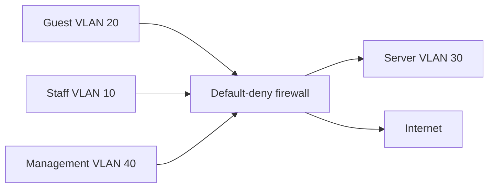

# Small business security lab

An auditable network segmentation design and executable policy model by Cristobal Samano Osuna. The project models the security requirements of a small business and validates allowed and denied flows with automated tests.

## Reproduce

Python 3.10+, no dependencies:

```shell
python policy_check.py policy.json guest servers tcp 445
python policy_check.py policy.json management servers tcp 22
python -m unittest -v
```

Expected decisions: default deny for guest-to-server SMB, allow by admin-ssh for management-to-server SSH.

## Business scenario and architecture

A small business has employees, visitors, an internal web application and a management station. Visitors need browsing but must never access the server or administrator network. Staff need HTTPS to the application, not SSH. Administration is restricted to the management zone.



Rules in `policy.json` use first-match semantics. The test suite encodes business requirements independently of rule order: guest isolation, application access, restricted administration, default-deny inbound and exception precedence.

## Risk register

| Risk | Control | Verification | Residual issue |
|---|---|---|---|
| Guest lateral movement | Separate VLAN and deny internal access | Negative flow tests | Physical switch configuration must match design |
| Stolen administrator password | MFA VPN and restricted management zone | Test MFA and session logs in deployment | MFA is a design requirement, not implemented here |
| Ransomware | Least privilege, patching, offline/immutable backups | Restore drill and access review | Segmentation cannot prevent all application abuse |
| Lost visibility | Central logs and synchronized clocks | Send test event and check timestamp | Logging platform not deployed here |

## Deployment and rollback plan

Inventory assets and owners first. Back up firewall/switch configuration; obtain a maintenance window and retain console access. Translate this model into the chosen firewall, initially in an isolated lab. Test permitted flows and forbidden flows from each VLAN, including IPv6. Record packet captures and actual rule counters. Only then deploy by small groups. Restore the known-good configuration using console access if critical traffic fails. Never apply a generic rule file blindly to a real network.

## Deliberate limitations

Zone-level TCP/UDP policy only: no state tracking, return traffic, NAT, ICMP, IPv6, application identity, subnet enforcement, VPN implementation or real packet tests. DNS rules are illustrative; production needs approved resolvers, TCP fallback and egress restrictions. Internet access is broad within specified ports. Passing unit tests proves the model's decisions, not network security. Expand the policy after documenting actual business needs.

## Entrevue — français

Présente les besoins métier, la séparation des réseaux, les tests négatifs et le retour arrière. Explique pourquoi une politique correcte sur papier peut échouer sur un pare-feu réel. Exercice: ajouter un serveur de sauvegarde avec seulement les flux nécessaires, puis écrire les tests avant les règles.
